<!-- ============================================================
  GITHUB PROFILE README — SKELETON
  1. Replace YOUR_USERNAME everywhere (Ctrl+F)
  2. Fill in every [bracketed] spot with your own words
  3. Delete these HTML comments when done (they don't show on GitHub anyway)
============================================================= -->

<!-- HEADER — capsule-render banner. Edit text= and desc= (use %20 for spaces, no # & /) -->
<!-- HEADER — anime GIF. Safer long-term: download it, upload to assets/ in this repo, and change src to ./assets/header.gif so the link can't break. -->
<p align="center">  </p> <h1 align="center">Hi, I'm Alonzo</h1> <p align="center">[your tagline]</p> 

<!-- CONTACT LINKS — shields.io badges. Swap in your real URLs --> 
<p align="center"> <a href="https://www.linkedin.com/in/[your-linkedin]"></a> <a href="mailto:[your-email]"></a> <!-- <a href="[your-site]"></a> --> </p>

---

## 👨‍💻 About Me

<!-- YAML-style block from the Medium guide. Write each value yourself — keep it short. -->
```yaml
Name: Alonzo
School: Arizona State University - Computer Science
Focus: Machine Learning, AI, Software Development, Bioinformatics
currently_building: Supervised learning application using logistic regression to predict NFL win probabilities 
Currently Learning: Deep Learning, Docker and Kubernetes, AlphaFold
Looking For: internships
fun_fact:  play piano and guitar, passionate about applying machine learning in biology and healthcare, huge sports fan
```

---

## 🚀 Featured Projects

<!-- 2–4 projects. One line each: what it does + what it shows about you. Link each repo. -->
| Project | What it is | Stack |
|---|---|---|
| [**[Project 1]**](https://github.com/YOUR_USERNAME/[repo]) | [one line] | [tools] |
| [**[Project 2]**](https://github.com/YOUR_USERNAME/[repo]) | [one line] | [tools] |
| [**[Project 3]**](https://github.com/YOUR_USERNAME/[repo]) | [one line] | [tools] |

---

## 🧰 Tools & Tech

<!-- DevIcon icons. Keep only what you can actually talk about in an interview. More at https://devicon.dev — copy the  and change width/height to 40. --> 
<p align="left"> <b>Languages</b><br/>        <!-- CHECK: if Scheme shows as a broken image, delete this line (DevIcon may not have it) -->  </p> <p align="left"> <b>Web</b><br/>   </p> <p align="left"> <b>Databases</b><br/>    </p> <p align="left"> <b>ML & Data</b><br/>   </p> <p align="left"> <b>DevOps & Cloud</b><br/>     </p>

---

## 📈 GitHub Stats

<!-- Cards are generated daily by .github/workflows/grs.yml using your own token, so they include private repo stats. They won't appear until the workflow runs once. -->
<p align="center">   </p> <!-- FOOTER banner (same style as header, flipped) --> <p align="center">  </p>
